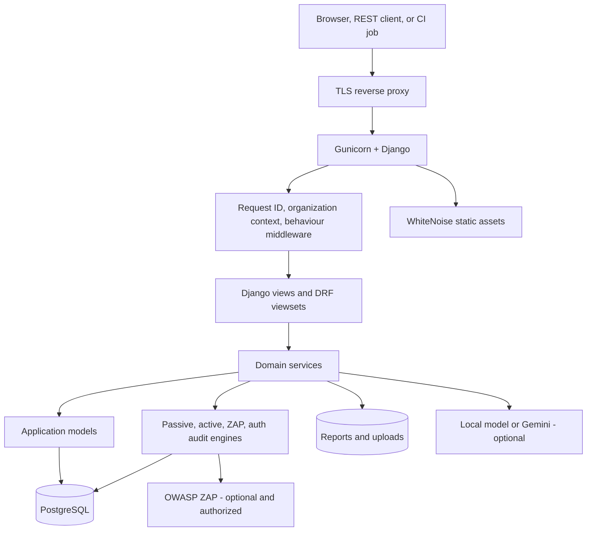
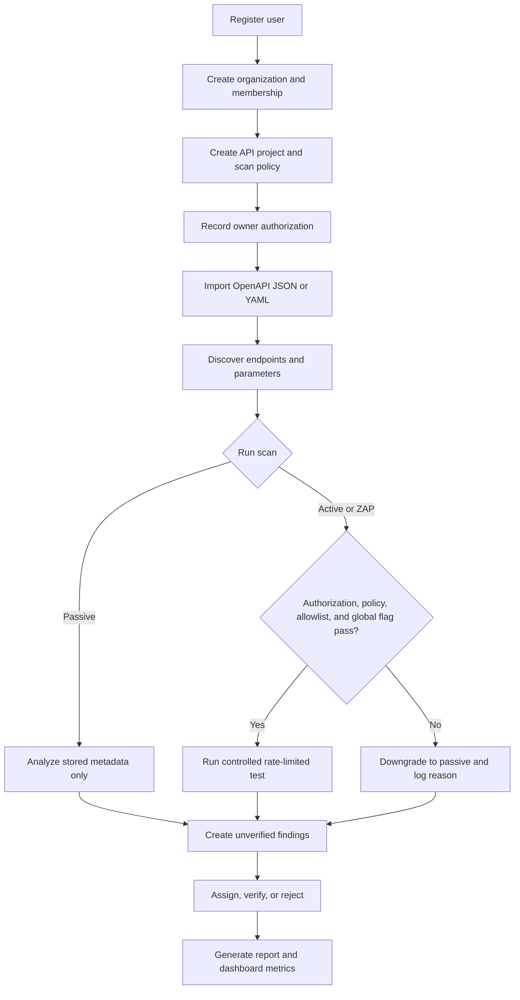

# API-Shield

| Field | Value |
| --- | --- |
| Repository | `Njbalamani/API-Shield` |
| Application folder | [`api-shield/`](api-shield/) |
| Product | APIShield — API security testing and threat detection platform |
| Owner | Njbalamani |
| Version | 1.0.0 |
| License | [MIT](LICENSE) — Copyright (c) 2026 Njbalamani |
| Stack | Python 3.12, Django 5.2, DRF, PostgreSQL 16, Gunicorn, WhiteNoise |
| Status | Validated: Django checks, migrations, 17 tests, Ruff, strict OpenAPI schema |

## Table of contents

| Section | Topic |
| --- | --- |
| [1](#1-repository-structure) | Repository structure |
| [2](#2-product-capabilities) | Product capabilities |
| [3](#3-architecture) | Architecture |
| [4](#4-project-workflow) | Project workflow |
| [5](#5-requirements-matrix) | Requirements matrix |
| [6](#6-command-structure) | Command structure |
| [7](#7-validation-status) | Validation status |
| [8](#8-documentation) | Documentation |
| [9](#9-license) | License |

## 1. Repository structure

```text
API-Shield/
├── api-shield/
│   ├── accounts/
│   ├── ai_analysis/
│   ├── api_projects/
│   ├── api_scanner/
│   ├── authentication_audit/
│   ├── behaviour_monitor/
│   ├── config/
│   ├── dashboard/
│   ├── docs/
│   ├── endpoint_discovery/
│   ├── organizations/
│   ├── reports/
│   ├── static/
│   ├── templates/
│   ├── tests/
│   ├── vulnerability_manager/
│   ├── manage.py
│   ├── requirements.txt
│   ├── Dockerfile
│   ├── docker-compose.yml
│   └── README.md
├── README.md
└── LICENSE
```

| Path | Purpose |
| --- | --- |
| [`api-shield/`](api-shield/) | Complete Django application source |
| [`api-shield/README.md`](api-shield/README.md) | Full installation, architecture, workflow, commands, API, database, and security documentation |
| [`api-shield/docs/`](api-shield/docs/) | Architecture, ER diagram, API, deployment, authorization, and threat-model documents |
| [`LICENSE`](LICENSE) | MIT license with Njbalamani as copyright holder |

## 2. Product capabilities

| Domain | Capability | Primary module |
| --- | --- | --- |
| Identity | Users, login attempts, API keys, JWT, OAuth2, roles | `accounts` |
| Tenancy | Organizations, memberships, active organization context | `organizations` |
| Inventory | Projects, OpenAPI specifications, scan policies | `api_projects` |
| Discovery | Endpoints, parameters, request and response schemas | `endpoint_discovery` |
| Scanning | Passive rules, controlled active tests, OWASP ZAP adapter | `api_scanner` |
| Authentication audit | Token, OAuth2, API key, and basic auth evidence | `authentication_audit` |
| Behaviour monitoring | Request logs, frequency checks, failure checks, sensitive path alerts | `behaviour_monitor` |
| Remediation | Assignment, verification, evidence, lifecycle status | `vulnerability_manager` |
| AI explanations | Local scikit-learn scoring with optional Gemini explanations | `ai_analysis` |
| Reporting | PDF and JSON report generation | `reports` |
| Dashboard | Metrics, charts, topology, finding distribution | `dashboard` |

## 3. Architecture



| Layer | Responsibility |
| --- | --- |
| Presentation | Django templates, REST API, Swagger and ReDoc |
| Transport | Gunicorn WSGI, ASGI entrypoint, WhiteNoise |
| Middleware | Security headers, request IDs, tenant context, behaviour monitoring |
| Application | Views, viewsets, services, permissions, scan orchestration |
| Domain | Models, constraints, status choices, audit records |
| Infrastructure | PostgreSQL, media storage, optional ZAP and Gemini integrations |

## 4. Project workflow



| Safety rule | Enforcement |
| --- | --- |
| Passive analysis is the default | `ScanPolicy.allow_passive_tests=True` |
| Active testing is opt-in | `ACTIVE_TESTING_ENABLED=False` and `ScanPolicy.allow_active_tests=False` |
| Owner approval is required | `authorization_confirmed` and `authorization_reference` |
| Target hosts are allowlisted | `ScanPolicy.allowed_hosts` |
| Rate and timeout limits are enforced | `MAX_ACTIVE_REQUESTS`, `SCAN_RATE_LIMIT_RPM`, `SCAN_TIMEOUT_SECONDS` |
| Findings are not auto-confirmed | `ScanFinding.verified=False` until human verification |
| Third-party targets are prohibited | Owned or contractually authorized systems only |

## 5. Requirements matrix

| Requirement | Implementation | Evidence |
| --- | --- | --- |
| Django MVT architecture | Django apps, templates, views, models, services | [`api-shield/config/urls.py`](api-shield/config/urls.py) |
| DRF API layer | Viewsets, serializers, exception handler, schema UI | [`api-shield/config/api.py`](api-shield/config/api.py) |
| PostgreSQL persistence | `DATABASE_URL`, production PostgreSQL, test SQLite | [`api-shield/config/settings.py`](api-shield/config/settings.py) |
| Custom CSS UI | `static/css/main.css`, no Bootstrap in custom assets | [`api-shield/static/`](api-shield/static/) |
| Three.js and Chart.js | Topology and dashboard scripts | [`api-shield/static/js/`](api-shield/static/js/) |
| JWT, OAuth2, API keys | Five DRF authentication classes | [`api-shield/accounts/authentication.py`](api-shield/accounts/authentication.py) |
| OWASP ZAP integration | Optional ZAP adapter with authorization gates | [`api-shield/api_scanner/engines/zap.py`](api-shield/api_scanner/engines/zap.py) |
| OpenAPI parsing | JSON and YAML import into endpoints and parameters | [`api-shield/endpoint_discovery/services.py`](api-shield/endpoint_discovery/services.py) |
| Real scanning functionality | Passive rules, controlled active checks, ZAP adapter | [`api-shield/api_scanner/`](api-shield/api_scanner/) |
| AI explanations | Local scikit-learn model and optional Gemini | [`api-shield/ai_analysis/services.py`](api-shield/ai_analysis/services.py) |
| Behaviour monitoring | Middleware logs requests and creates alerts | [`api-shield/behaviour_monitor/`](api-shield/behaviour_monitor/) |
| Vulnerability workflow | Assignment, verification, and evidence records | [`api-shield/vulnerability_manager/`](api-shield/vulnerability_manager/) |
| PDF and JSON reports | ReportLab and JSON report builders | [`api-shield/reports/services.py`](api-shield/reports/services.py) |
| Secure uploads and validation | Extension validation, 10 MB limits, tenant scoping | [`api-shield/config/settings.py`](api-shield/config/settings.py) |
| Authorized active testing only | Global, project, policy, and host allowlist gates | [`docs/scanning-authorization.md`](api-shield/docs/scanning-authorization.md) |
| Documentation with tables and diagrams | Root and project READMEs plus six documents | [`api-shield/docs/`](api-shield/docs/) |
| MIT license with owner name | Copyright (c) 2026 Njbalamani | [`LICENSE`](LICENSE) |

## 6. Command structure

All application commands run from the [`api-shield/`](api-shield/) folder.

| Group | Command | Purpose |
| --- | --- | --- |
| Environment | `py -3 -m venv .venv` | Create virtual environment |
| Environment | `.venv\Scripts\Activate.ps1` | Activate on Windows PowerShell |
| Environment | `pip install -r requirements.txt` | Install dependencies |
| Environment | `Copy-Item .env.example .env` | Create local environment template |
| Database | `python manage.py migrate` | Apply migrations |
| Database | `python manage.py makemigrations --check --dry-run` | Verify model and migration state |
| Seed | `python manage.py seed_rules` | Load scan rule catalogue |
| Seed | `python manage.py seed_demo_data` | Load labelled controlled-lab demo data |
| Run | `python manage.py runserver` | Start local development server |
| Admin | `python manage.py createsuperuser` | Create administrator account |
| Static | `python manage.py collectstatic --noinput` | Collect WhiteNoise assets |
| Validation | `python manage.py check` | Run Django system checks |
| Validation | `python manage.py test` | Run the 17-test suite |
| Validation | `ruff check .` | Lint Python source |
| Validation | `ruff format --check .` | Check Python formatting |
| Validation | `python manage.py spectacular --validate --fail-on-warn --file schema.yml` | Validate OpenAPI schema |
| Docker | `docker compose build` | Build the application image |
| Docker | `docker compose up -d` | Start web and database services |
| Docker | `docker compose logs -f web` | Stream web logs |
| Docker | `docker compose down` | Stop services |

## 7. Validation status

| Check | Result |
| --- | --- |
| `python manage.py check` | Passed with no issues |
| `python manage.py makemigrations --check --dry-run` | No changes detected |
| `python manage.py migrate` | All migrations applied in test database |
| `python manage.py test` | 17 tests passed |
| `ruff check .` | All checks passed |
| `ruff format --check .` | All 153 Python files formatted |
| Template compilation | 42 templates compiled |
| Strict OpenAPI schema | Passed with zero warnings and errors |
| Bootstrap usage in custom templates, CSS, JS, and docs | None found |

## 8. Documentation

| Document | Purpose |
| --- | --- |
| [Project README](api-shield/README.md) | Complete product and implementation reference |
| [Architecture](api-shield/docs/architecture.md) | Layers, runtime topology, request, scan, AI, and monitoring flows |
| [ER diagram](api-shield/docs/er-diagram.md) | Entity relationships and column-level model reference |
| [API reference](api-shield/docs/api.md) | Endpoints, authentication, responses, and examples |
| [Deployment guide](api-shield/docs/deployment.md) | Local, Docker, production, TLS, backup, and troubleshooting |
| [Scanning authorization](api-shield/docs/scanning-authorization.md) | Safe-testing approval rules and checklist |
| [Threat model](api-shield/docs/threat-model.md) | OWASP mapping, trust boundaries, threats, and mitigations |

## 9. License

APIShield is distributed under the MIT License.

Copyright (c) 2026 Njbalamani. See [LICENSE](LICENSE).
