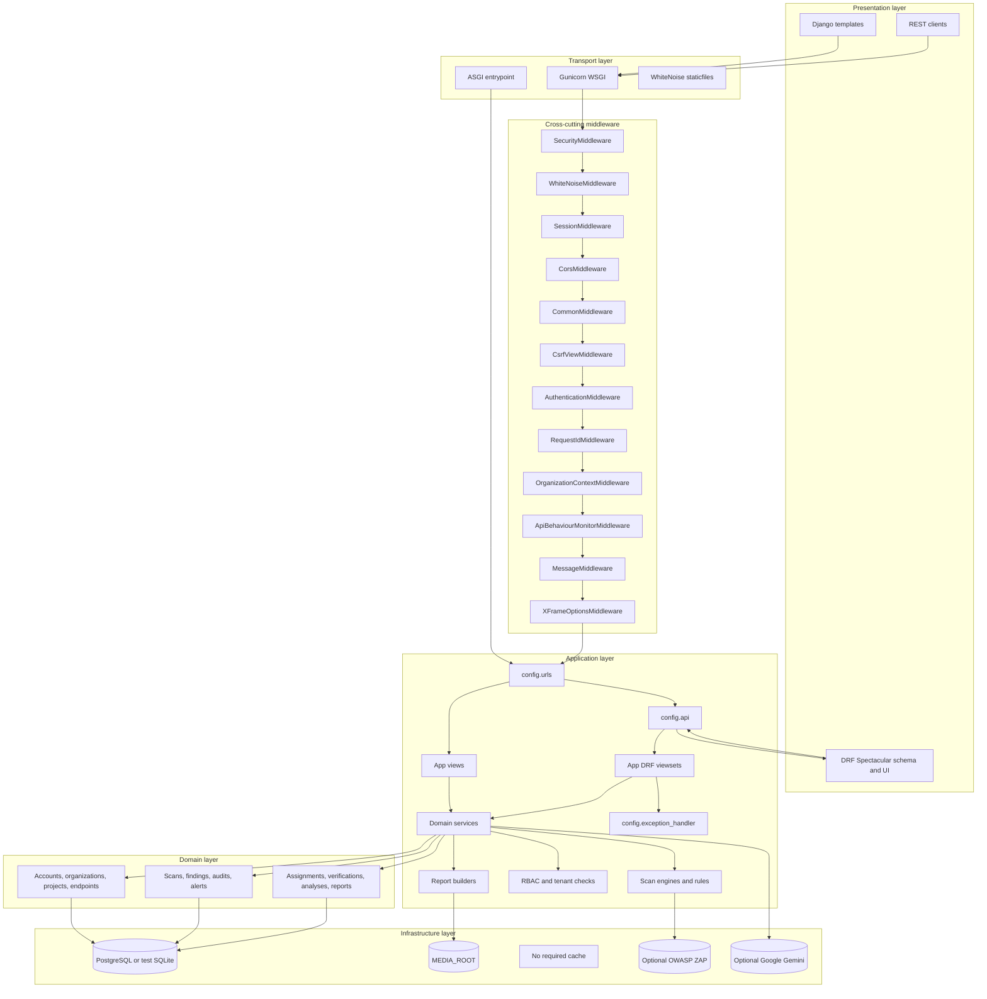
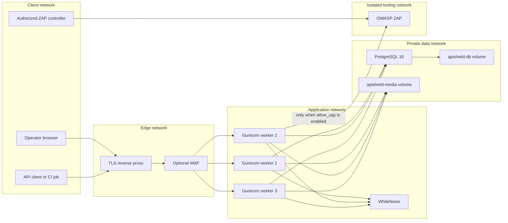
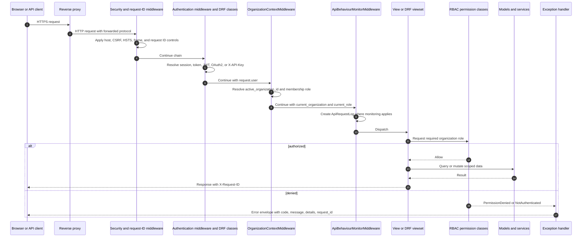
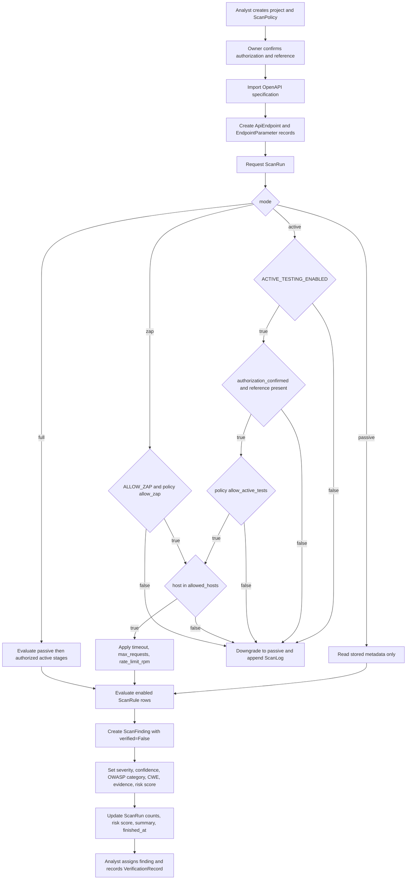
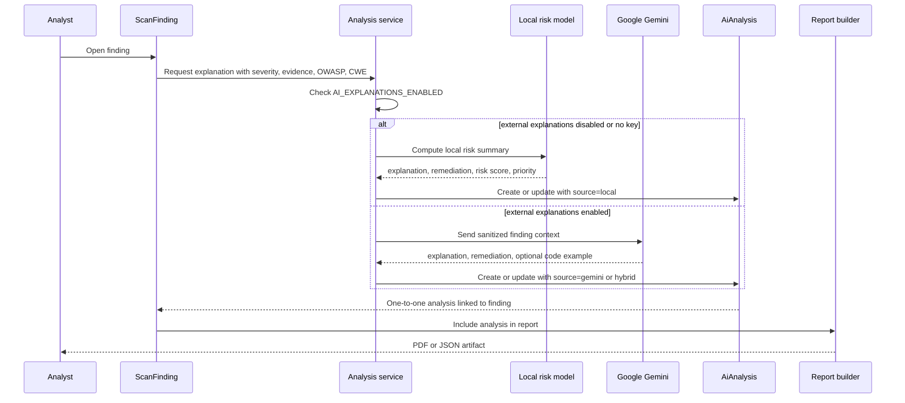
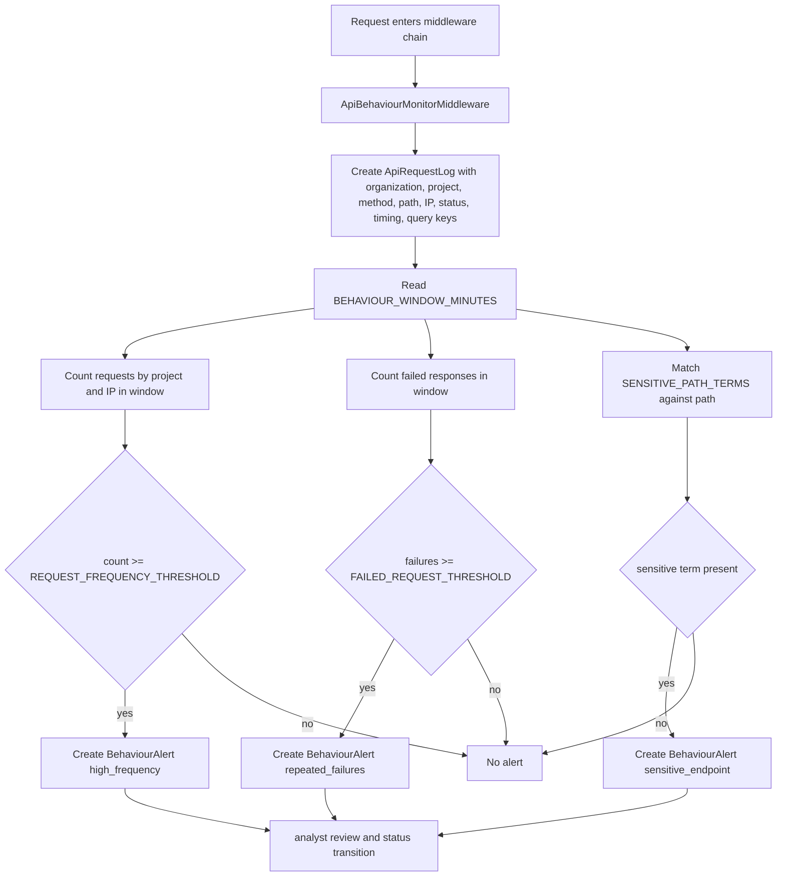

# APIShield architecture

| Field | Value |
| --- | --- |
| Version | 1.0.0 |
| Date | 24/11/2026 |
| Scope | Application layers, runtime topology, request flow, scanning flow, AI flow, monitoring flow, architecture decisions |

## 1. Layered architecture

APIShield is a modular Django monolith with clear boundaries between transport, middleware, application, domain, and persistence layers. The settings module composes twenty-four installed apps, including eleven project apps, a fixed middleware order, five DRF authentication classes, and a single SQL database connection that switches to in-memory SQLite under `TESTING=True`.

### Layer responsibilities

| Layer | Owns | Does not own |
| --- | --- | --- |
| Presentation | Templates, REST payloads, schema UI | Authorization decisions, persistence rules |
| Transport | WSGI/ASGI, static file serving, process concurrency | Domain state |
| Middleware | Request IDs, tenant resolution, monitoring, security headers | Business workflows |
| Application | Routing, use cases, permissions, scan orchestration, reporting | Connection pooling details |
| Domain | Model invariants, relationships, status choices, constraint definitions | HTTP concerns |
| Infrastructure | PostgreSQL, media storage, optional external engines | Authorization policy |

## 2. Runtime topology

### Process model

| Process | Responsibility | Scaling guidance |
| --- | --- | --- |
| Gunicorn worker | Serves Django WSGI requests | Default compose configuration uses three workers and a 120-second timeout |
| PostgreSQL | Stores all relational state | Use managed backups, connection limits, and TLS on the private network |
| WhiteNoise | Serves collected static assets from the web process | Collected at image build and container startup |
| OWASP ZAP | Optional active-testing engine | Keep isolated, never co-located with production data |
| CI runner | Runs lint, Django checks, migration check, tests | Uses `TESTING=True` and requires no external services |

## 3. Request flow

### Tenant resolution rules

| Situation | Result |
| --- | --- |
| Session contains a valid `active_organization_id` and active membership | That organization becomes `request.current_organization`; role comes from membership |
| Session organization is missing, inactive, or not a membership | First active organization by name is selected |
| API key authenticates | `request.current_organization` is set by `ApiKeyAuthentication` and inactive organizations are rejected |
| User has no active organization | `request.current_organization` remains `None`; member-only permissions deny access |
| User is superuser | RBAC helper allows the operation; organization context is still required by member permissions |

## 4. Scanning flow

### Scan safety gates

| Gate | Source | Failure behaviour |
| --- | --- | --- |
| Global active switch | `ACTIVE_TESTING_ENABLED` | Downgrade to passive |
| Owner confirmation | `ApiProject.authorization_confirmed` | Downgrade to passive |
| Authorization reference | `ApiProject.authorization_reference` | Downgrade to passive |
| Project active permission | `ScanPolicy.allow_active_tests` | Downgrade to passive |
| Host allowlist | `ScanPolicy.allowed_hosts` | Reject or downgrade |
| ZAP permission | `ALLOW_ZAP` and `ScanPolicy.allow_zap` | Downgrade or reject |
| Request limit | `MAX_ACTIVE_REQUESTS`, `ScanPolicy.max_requests` | Stop scanning at cap |
| Rate limit | `SCAN_RATE_LIMIT_RPM`, `ScanPolicy.rate_limit_rpm` | Throttle requests |
| Timeout | `SCAN_TIMEOUT_SECONDS`, `ScanPolicy.timeout_seconds` | Abort request and log |

## 5. AI flow

### AI data rules

| Rule | Implementation |
| --- | --- |
| Disabled by default | `AI_EXPLANATIONS_ENABLED=False` |
| Credential isolated | `GEMINI_API_KEY` only consumed when external source is enabled |
| Model configurable | `GEMINI_MODEL` defaults to `gemini-1.5-flash` |
| Local fallback | `AiAnalysis.Source.LOCAL` and default `model_name=local-risk-model` |
| Finding linkage | `AiAnalysis.finding` is a one-to-one relation |
| Human review preserved | AI output never sets `ScanFinding.verified=True` |

## 6. Monitoring flow

### Monitoring data model

| Signal | Stored field | Alert type |
| --- | --- | --- |
| Request count in window | `ApiRequestLog.timestamp` | `high_frequency` |
| Repeated failures | `ApiRequestLog.status_code` | `repeated_failures` |
| Sensitive path access | `ApiRequestLog.path` | `sensitive_endpoint` |
| Novel combination of IP, path, and query keys | `ip_address`, `path`, `query_keys` | `unusual_pattern` |

## 7. Architecture decision table

| Decision | Alternatives considered | Rationale | Trade-off |
| --- | --- | --- | --- |
| Modular Django monolith | Separate microservices per app | Shared tenant model, transactions, and simpler deployment | Workers scale as a unit |
| Custom `User` with email login | Username-based default user | Email is the platform identity and appears in audit trails | Requires `AUTH_USER_MODEL` from first migration |
| Organization membership roles | Global roles only | Same person can be analyst in one tenant and viewer in another | Role checks require organization context |
| Five DRF authentication classes | Single token scheme | Supports browser, service tokens, JWT, OAuth2, and API keys | More authentication surface to test |
| SHA-256 API key digest | Plaintext storage or reversible encryption | Raw key is shown once; stored value is not usable as a credential | Digest requires exact key normalization |
| PostgreSQL in production, SQLite in tests | SQLite everywhere | Production constraints and JSON behaviour match deployment; tests stay fast | Test and production engines differ |
| Passive scan default | Active scan default | Prevents accidental traffic to unauthorized systems | Active coverage needs explicit setup |
| Double-gated ZAP | Direct ZAP calls from any analyst | Global and per-project controls reduce misuse | More configuration steps |
| Findings start unverified | Auto-accept scanner output | Scanner rules can produce false positives | Requires human triage |
| OpenAPI as inventory source | Manual endpoint entry only | Fast, standardized, reproducible discovery | Depends on specification accuracy |
| Local AI fallback | External AI only | Works without data sharing and credentials | Lower explanation depth |
| Request-ID context variable | No correlation ID | Correlates logs across workers and error envelopes | Middleware must always reset context |
| Uniform DRF error envelope | Framework default errors | Stable client contract and explicit request IDs | Custom handler must cover all exceptions |
| WhiteNoise static serving | Separate static server | Fewer moving parts in container deployment | Static assets served by each web worker |
| Volume-backed reports | Local ephemeral storage | Reports survive container recreation | Backup must include media volume |
