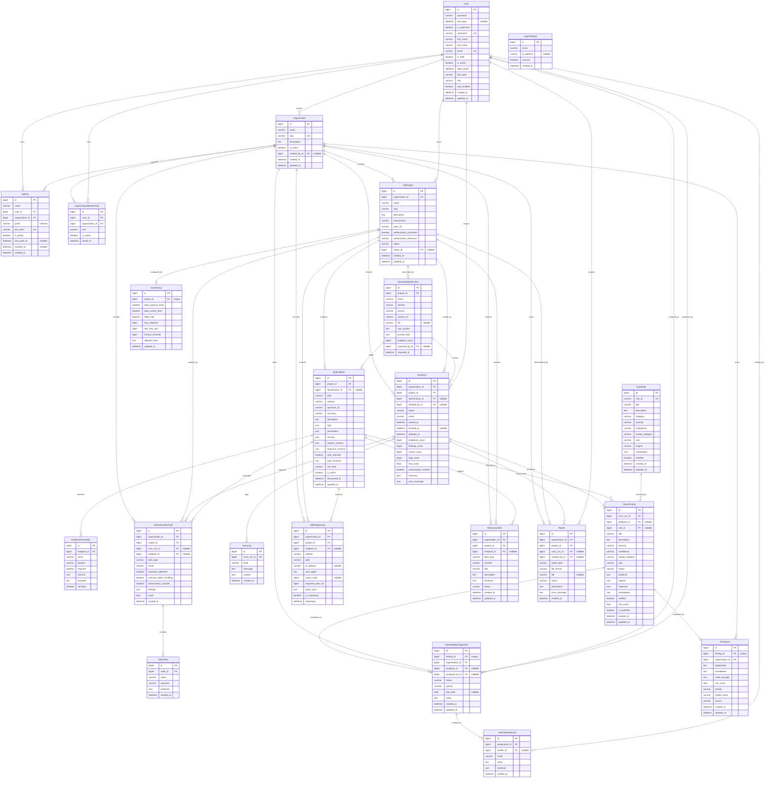

# APIShield entity-relationship reference

| Field | Value |
| --- | --- |
| Version | 1.0.0 |
| Date | 24/11/2026 |
| Source | `accounts`, `organizations`, `api_projects`, `endpoint_discovery`, `api_scanner`, `authentication_audit`, `behaviour_monitor`, `vulnerability_manager`, `ai_analysis`, `reports` models |

## 1. Mermaid ER diagram

## 2. Column-level model reference

### `accounts.User` → `accounts_user`

| Column | Type | Constraints | Description |
| --- | --- | --- | --- |
| `id` | BigAutoField | PK | Primary key inherited from Django's default auto field |
| `password` | CharField(128) | Required | Hashed password |
| `last_login` | DateTimeField | NULL | Last successful authentication timestamp |
| `is_superuser` | BooleanField | Required, default `False` | Django superuser flag; bypasses role ranking |
| `username` | CharField(150) | UNIQUE | Inherited Django username |
| `first_name` | CharField(150) | Blank allowed | Inherited given name |
| `last_name` | CharField(150) | Blank allowed | Inherited family name |
| `email` | EmailField | UNIQUE, `USERNAME_FIELD` | Login identifier |
| `is_staff` | BooleanField | Required | Django admin site access flag |
| `is_active` | BooleanField | Required | Account activation flag |
| `date_joined` | DateTimeField | Required | Account creation timestamp |
| `full_name` | CharField(160) | Required | Display name used by `__str__` |
| `role` | CharField(20) | Choices: `admin`, `analyst`, `developer`, `viewer`; default `analyst` | Global role |
| `mfa_enabled` | BooleanField | Default `False` | MFA enrollment indicator |
| `created_at` | DateTimeField | `auto_now_add` | Record creation timestamp |
| `updated_at` | DateTimeField | `auto_now` | Last update timestamp |

### `accounts.LoginAttempt` → `accounts_loginattempt`

| Column | Type | Constraints | Description |
| --- | --- | --- | --- |
| `id` | BigAutoField | PK | Primary key |
| `email` | EmailField | Required | Submitted login identifier |
| `ip_address` | GenericIPAddressField | NULL, blank allowed | Source IP when available |
| `success` | BooleanField | Default `False` | Whether the attempt succeeded |
| `created_at` | DateTimeField | `auto_now_add` | Attempt timestamp; default ordering is descending |

### `accounts.ApiKey` → `accounts_apikey`

| Column | Type | Constraints | Description |
| --- | --- | --- | --- |
| `id` | BigAutoField | PK | Primary key |
| `name` | CharField(120) | Required | Human-readable key label |
| `user_id` | FK → `accounts_user` | CASCADE | Owner of the key |
| `organization_id` | FK → `organizations_organization` | CASCADE | Organization scope |
| `prefix` | CharField(16) | Indexed | Displayable key prefix |
| `key_hash` | CharField(64) | UNIQUE | SHA-256 digest of the raw key |
| `is_active` | BooleanField | Default `True` | Enables authentication |
| `last_used_at` | DateTimeField | NULL | Last successful authentication |
| `revoked_at` | DateTimeField | NULL | Revocation timestamp |
| `created_at` | DateTimeField | `auto_now_add` | Creation timestamp |

### `organizations.Organization` → `organizations_organization`

| Column | Type | Constraints | Description |
| --- | --- | --- | --- |
| `id` | BigAutoField | PK | Primary key |
| `name` | CharField(180) | Required | Display name |
| `slug` | SlugField(200) | UNIQUE | Stable URL and lookup identifier |
| `description` | TextField | Blank allowed | Organization description |
| `is_active` | BooleanField | Default `True` | Tenant activation flag |
| `created_by_id` | FK → `accounts_user` | SET_NULL, NULL | Creator |
| `created_at` | DateTimeField | `auto_now_add` | Creation timestamp |
| `updated_at` | DateTimeField | `auto_now` | Last update timestamp |

### `organizations.OrganizationMembership` → `organizations_organizationmembership`

| Column | Type | Constraints | Description |
| --- | --- | --- | --- |
| `id` | BigAutoField | PK | Primary key |
| `user_id` | FK → `accounts_user` | CASCADE | Member |
| `organization_id` | FK → `organizations_organization` | CASCADE | Tenant |
| `role` | CharField(20) | Choices: `admin`, `analyst`, `developer`, `viewer`; default `analyst` | Organization-scoped role |
| `is_active` | BooleanField | Default `True` | Membership activation flag |
| `joined_at` | DateTimeField | `auto_now_add` | Membership timestamp |

Constraint: `unique_active_user_organization` is a `UniqueConstraint` on `(user, organization)` where `is_active=True`.

### `api_projects.ApiProject` → `api_projects_apiproject`

| Column | Type | Constraints | Description |
| --- | --- | --- | --- |
| `id` | BigAutoField | PK | Primary key |
| `organization_id` | FK → `organizations_organization` | CASCADE | Tenant |
| `name` | CharField(180) | Required | Project display name |
| `slug` | SlugField(200) | Unique with `organization_id` | Project URL identifier |
| `description` | TextField | Blank allowed | Project notes |
| `environment` | CharField(20) | Choices: `development`, `staging`, `production`, `controlled_lab`; default `controlled_lab` | Target environment classification |
| `base_url` | URLField(500) | Blank allowed | Declared target base URL |
| `authorization_confirmed` | BooleanField | Default `False` | Owner confirmation for active tests |
| `authorization_reference` | CharField(200) | Blank allowed | Ticket, engagement, or approval reference |
| `status` | CharField(20) | Choices: `active`, `archived`; default `active` | Project lifecycle state |
| `owner_id` | FK → `accounts_user` | SET_NULL, NULL | Accountable owner |
| `created_at` | DateTimeField | `auto_now_add` | Creation timestamp |
| `updated_at` | DateTimeField | `auto_now` | Last update timestamp |

Constraint: `unique_project_slug_per_org` on `(organization, slug)`.

### `api_projects.OpenApiSpecification` → `api_projects_openapispecification`

| Column | Type | Constraints | Description |
| --- | --- | --- | --- |
| `id` | BigAutoField | PK | Primary key |
| `project_id` | FK → `api_projects_apiproject` | CASCADE | Project |
| `name` | CharField(180) | Required | Specification label |
| `version` | CharField(80) | Blank allowed | Declared specification version |
| `source` | CharField(20) | Choices: `file`, `url`, `pasted`; default `file` | Import method |
| `source_url` | URLField(500) | Blank allowed | Remote specification URL |
| `file` | FileField | Blank allowed; JSON/YAML/TXT/YML extensions | Uploaded file path under `openapi/` |
| `raw_content` | TextField | Blank allowed | Original pasted or downloaded content |
| `parsed_data` | JSONField | Default `{}` | Parsed OpenAPI document |
| `endpoint_count` | PositiveIntegerField | Default `0` | Imported endpoint count |
| `imported_by_id` | FK → `accounts_user` | SET_NULL, NULL | Importing user |
| `imported_at` | DateTimeField | `auto_now_add` | Import timestamp |

### `api_projects.ScanPolicy` → `api_projects_scanpolicy`

| Column | Type | Constraints | Description |
| --- | --- | --- | --- |
| `id` | BigAutoField | PK | Primary key |
| `project_id` | OneToOneField → `api_projects_apiproject` | CASCADE, unique | Governed project |
| `allow_passive_tests` | BooleanField | Default `True` | Permits passive analysis |
| `allow_active_tests` | BooleanField | Default `False` | Permits controlled active tests |
| `allow_zap` | BooleanField | Default `False` | Permits ZAP engine use |
| `max_requests` | PositiveIntegerField | Default `40` | Active request ceiling |
| `rate_limit_rpm` | PositiveIntegerField | Default `30` | Request rate ceiling |
| `timeout_seconds` | PositiveIntegerField | Default `15` | Per-request timeout |
| `allowed_hosts` | TextField | Blank allowed | Comma-separated approved hostnames |
| `updated_at` | DateTimeField | `auto_now` | Last policy update |

### `endpoint_discovery.ApiEndpoint` → `endpoint_discovery_apiendpoint`

| Column | Type | Constraints | Description |
| --- | --- | --- | --- |
| `id` | BigAutoField | PK | Primary key |
| `project_id` | FK → `api_projects_apiproject` | CASCADE | Project |
| `specification_id` | FK → `api_projects_openapispecification` | SET_NULL, NULL, blank | Source specification |
| `path` | CharField(500) | Required with `method`; unique with project | OpenAPI path template |
| `method` | CharField(10) | Choices: `GET`, `POST`, `PUT`, `PATCH`, `DELETE`, `OPTIONS`, `HEAD` | HTTP method |
| `operation_id` | CharField(180) | Blank allowed | OpenAPI `operationId` |
| `summary` | CharField(300) | Blank allowed | Short operation summary |
| `description` | TextField | Blank allowed | Long operation description |
| `tags` | JSONField | Default `[]` | OpenAPI tags |
| `parameters` | JSONField | Default `[]` | Denormalized parameter metadata |
| `security` | JSONField | Default `[]` | Declared security requirements |
| `request_schema` | JSONField | Default `{}` | Request body schema |
| `response_schema` | JSONField | Default `{}` | Response schema |
| `auth_required` | BooleanField | Default `False` | Whether authentication is declared |
| `auth_schemes` | JSONField | Default `[]` | Declared auth scheme names |
| `risk_level` | CharField(20) | Choices: `none`, `low`, `medium`, `high`, `critical`; default `none` | Assigned risk level |
| `is_active` | BooleanField | Default `True` | Endpoint activation flag |
| `discovered_at` | DateTimeField | `auto_now_add` | Discovery timestamp |
| `updated_at` | DateTimeField | `auto_now` | Last update timestamp |

Constraint: `unique_endpoint_per_project` on `(project, path, method)`.

### `endpoint_discovery.EndpointParameter` → `endpoint_discovery_endpointparameter`

| Column | Type | Constraints | Description |
| --- | --- | --- | --- |
| `id` | BigAutoField | PK | Primary key |
| `endpoint_id` | FK → `endpoint_discovery_apiendpoint` | CASCADE | Parent endpoint |
| `name` | CharField(180) | Required | Parameter name |
| `location` | CharField(20) | Choices: `path`, `query`, `header`, `cookie`, `body` | Parameter location |
| `required` | BooleanField | Default `False` | OpenAPI required flag |
| `schema` | JSONField | Default `{}` | Parameter schema |
| `example` | TextField | Blank allowed | Example value |
| `sensitive` | BooleanField | Default `False` | Contains credentials or secrets |

Constraint: `unique_parameter_per_endpoint` on `(endpoint, name, location)`.

### `api_scanner.ScanRule` → `api_scanner_scanrule`

| Column | Type | Constraints | Description |
| --- | --- | --- | --- |
| `id` | BigAutoField | PK | Primary key |
| `rule_id` | CharField(80) | UNIQUE | Stable rule identifier |
| `title` | CharField(220) | Required | Rule title |
| `description` | TextField | Required | Rule explanation |
| `category` | CharField(120) | Required | Rule grouping |
| `severity` | CharField(20) | Choices: `info`, `low`, `medium`, `high`, `critical`; default `medium` | Default finding severity |
| `confidence` | CharField(20) | Default `medium` | Rule confidence label |
| `owasp_category` | CharField(120) | Blank allowed | OWASP API category reference |
| `cwe` | CharField(40) | Blank allowed | CWE identifier |
| `engine` | CharField(30) | Choices: `custom`, `zap`, `authentication`, `behaviour`; default `custom` | Producing engine |
| `remediation` | JSONField | Default `{}` | Structured remediation guidance |
| `enabled` | BooleanField | Default `True` | Rule activation flag |
| `created_at` | DateTimeField | `auto_now_add` | Creation timestamp |
| `updated_at` | DateTimeField | `auto_now` | Last update timestamp |

### `api_scanner.ScanRun` → `api_scanner_scanrun`

| Column | Type | Constraints | Description |
| --- | --- | --- | --- |
| `id` | BigAutoField | PK | Primary key |
| `organization_id` | FK → `organizations_organization` | CASCADE | Tenant |
| `project_id` | FK → `api_projects_apiproject` | CASCADE | Tested project |
| `specification_id` | FK → `api_projects_openapispecification` | SET_NULL, NULL, blank | Source specification |
| `initiated_by_id` | FK → `accounts_user` | SET_NULL, NULL | Requesting user |
| `status` | CharField(20) | Choices: `pending`, `running`, `completed`, `failed`, `cancelled`; default `pending` | Lifecycle state |
| `mode` | CharField(20) | Choices: `passive`, `active`, `zap`, `full`; default `passive` | Scan mode |
| `started_at` | DateTimeField | `auto_now_add` | Start timestamp |
| `finished_at` | DateTimeField | NULL | Completion timestamp |
| `updated_at` | DateTimeField | `auto_now` | Last update timestamp |
| `endpoints_count` | PositiveIntegerField | Default `0` | Endpoints evaluated |
| `findings_count` | PositiveIntegerField | Default `0` | Findings produced |
| `critical_count` | PositiveIntegerField | Default `0` | Critical findings |
| `high_count` | PositiveIntegerField | Default `0` | High findings |
| `risk_score` | FloatField | Default `0` | Aggregate risk score |
| `authorization_verified` | BooleanField | Default `False` | Authorization gate result |
| `summary` | JSONField | Default `{}` | Engine summary |
| `error_message` | TextField | Blank allowed | Failure detail |

### `api_scanner.ScanFinding` → `api_scanner_scanfinding`

| Column | Type | Constraints | Description |
| --- | --- | --- | --- |
| `id` | BigAutoField | PK | Primary key |
| `scan_run_id` | FK → `api_scanner_scanrun` | CASCADE | Parent scan |
| `endpoint_id` | FK → `endpoint_discovery_apiendpoint` | SET_NULL, NULL, blank | Affected endpoint |
| `rule_id` | FK → `api_scanner_scanrule` | SET_NULL, NULL, blank | Matched rule |
| `title` | CharField(240) | Required | Finding title |
| `description` | TextField | Required | Finding detail |
| `severity` | CharField(20) | Choices: `info`, `low`, `medium`, `high`, `critical`; default `medium` | Finding severity |
| `confidence` | CharField(20) | Default `medium` | Finding confidence |
| `owasp_category` | CharField(120) | Blank allowed | OWASP API category reference |
| `cwe` | CharField(40) | Blank allowed | CWE identifier |
| `status` | CharField(30) | Choices: `open`, `in_progress`, `resolved`, `false_positive`, `accepted_risk`; default `open` | Triage state |
| `evidence` | JSONField | Default `{}` | Supporting evidence |
| `request` | JSONField | Default `{}` | Request context |
| `response` | JSONField | Default `{}` | Response context |
| `remediation` | JSONField | Default `{}` | Structured remediation guidance |
| `verified` | BooleanField | Default `False` | Human verification state |
| `risk_score` | FloatField | Default `0` | Computed risk score |
| `is_synthetic` | BooleanField | Default `False` | Demo or generated-data marker |
| `created_at` | DateTimeField | `auto_now_add` | Creation timestamp |
| `updated_at` | DateTimeField | `auto_now` | Last update timestamp |

Default ordering is `-risk_score, -created_at`.

### `api_scanner.ScanLog` → `api_scanner_scanlog`

| Column | Type | Constraints | Description |
| --- | --- | --- | --- |
| `id` | BigAutoField | PK | Primary key |
| `scan_run_id` | FK → `api_scanner_scanrun` | CASCADE | Parent scan |
| `level` | CharField(20) | Default `INFO` | Log level |
| `message` | TextField | Required | Log message |
| `context` | JSONField | Default `{}` | Structured context |
| `created_at` | DateTimeField | `auto_now_add` | Event timestamp |

### `authentication_audit.AuthenticationAudit` → `authentication_audit_authenticationaudit`

| Column | Type | Constraints | Description |
| --- | --- | --- | --- |
| `id` | BigAutoField | PK | Primary key |
| `organization_id` | FK → `organizations_organization` | CASCADE | Tenant |
| `project_id` | FK → `api_projects_apiproject` | CASCADE | Audited project |
| `scan_run_id` | FK → `api_scanner_scanrun` | SET_NULL, NULL, blank | Related scan |
| `endpoint_id` | FK → `endpoint_discovery_apiendpoint` | SET_NULL, NULL, blank | Audited endpoint |
| `auth_type` | CharField(20) | Choices: `jwt`, `oauth2`, `api_key`, `basic`, `none`, `unknown`; default `unknown` | Detected authentication type |
| `result` | CharField(10) | Choices: `pass`, `warn`, `fail`; default `pass` | Audit result |
| `expiration_detected` | BooleanField | Default `False` | Token expiration evidence |
| `insecure_token_handling` | BooleanField | Default `False` | Insecure handling evidence |
| `authorization_controls` | BooleanField | Default `False` | Authorization control evidence |
| `findings` | JSONField | Default `[]` | Detailed audit findings |
| `score` | FloatField | Default `100` | Audit score |
| `created_at` | DateTimeField | `auto_now_add` | Creation timestamp |

### `authentication_audit.TokenTest` → `authentication_audit_tokentest`

| Column | Type | Constraints | Description |
| --- | --- | --- | --- |
| `id` | BigAutoField | PK | Primary key |
| `audit_id` | FK → `authentication_audit_authenticationaudit` | CASCADE | Parent audit |
| `name` | CharField(180) | Required | Test name |
| `outcome` | CharField(20) | Required | Test outcome |
| `evidence` | JSONField | Default `{}` | Test evidence |
| `created_at` | DateTimeField | `auto_now_add` | Creation timestamp |

### `behaviour_monitor.ApiRequestLog` → `behaviour_monitor_apirequestlog`

| Column | Type | Constraints | Description |
| --- | --- | --- | --- |
| `id` | BigAutoField | PK | Primary key |
| `organization_id` | FK → `organizations_organization` | CASCADE | Tenant |
| `project_id` | FK → `api_projects_apiproject` | CASCADE | Receiving project |
| `endpoint_id` | FK → `endpoint_discovery_apiendpoint` | SET_NULL, NULL, blank | Matched endpoint |
| `method` | CharField(10) | Required | HTTP method |
| `path` | CharField(500) | Required | Request path |
| `ip_address` | GenericIPAddressField | NULL, blank | Source IP |
| `user_agent` | TextField | Blank allowed | User-Agent header |
| `status_code` | PositiveIntegerField | NULL, blank | Response status when known |
| `response_time_ms` | PositiveIntegerField | Default `0` | Response duration |
| `query_keys` | JSONField | Default `[]` | Query parameter names |
| `is_suspicious` | BooleanField | Default `False` | Suspicion marker |
| `timestamp` | DateTimeField | `auto_now_add`, indexed | Observation timestamp |

Indexes: `(project, timestamp)`, `(ip_address, timestamp)`, `(is_suspicious, timestamp)`.

### `behaviour_monitor.BehaviourAlert` → `behaviour_monitor_behaviouralert`

| Column | Type | Constraints | Description |
| --- | --- | --- | --- |
| `id` | BigAutoField | PK | Primary key |
| `organization_id` | FK → `organizations_organization` | CASCADE | Tenant |
| `project_id` | FK → `api_projects_apiproject` | CASCADE | Monitored project |
| `endpoint_id` | FK → `endpoint_discovery_apiendpoint` | SET_NULL, NULL, blank | Related endpoint |
| `alert_type` | CharField(30) | Choices: `high_frequency`, `repeated_failures`, `sensitive_endpoint`, `unusual_pattern` | Detection category |
| `severity` | CharField(20) | Choices: `info`, `low`, `medium`, `high`, `critical`; default `medium` | Alert severity |
| `title` | CharField(220) | Required | Alert title |
| `description` | TextField | Required | Alert explanation |
| `evidence` | JSONField | Default `{}` | Detection evidence |
| `status` | CharField(20) | Choices: `open`, `acknowledged`, `resolved`; default `open` | Alert lifecycle state |
| `created_at` | DateTimeField | `auto_now_add` | Creation timestamp |
| `updated_at` | DateTimeField | `auto_now` | Last update timestamp |

### `vulnerability_manager.VulnerabilityAssignment` → `vulnerability_manager_vulnerabilityassignment`

| Column | Type | Constraints | Description |
| --- | --- | --- | --- |
| `id` | BigAutoField | PK | Primary key |
| `finding_id` | OneToOneField → `api_scanner_scanfinding` | CASCADE, unique | Assigned finding |
| `organization_id` | FK → `organizations_organization` | CASCADE | Tenant |
| `assignee_id` | FK → `accounts_user` | SET_NULL, NULL | Assigned engineer |
| `assigned_by_id` | FK → `accounts_user` | SET_NULL, NULL | Assigning user |
| `status` | CharField(20) | Choices: `assigned`, `in_progress`, `fixed`, `reopened`, `closed`; default `assigned` | Remediation status |
| `priority` | CharField(20) | Choices: `low`, `medium`, `high`, `urgent`; default `medium` | Work priority |
| `due_date` | DateField | NULL, blank | Target completion date |
| `notes` | TextField | Blank allowed | Remediation notes |
| `created_at` | DateTimeField | `auto_now_add` | Creation timestamp |
| `updated_at` | DateTimeField | `auto_now` | Last update timestamp |

### `vulnerability_manager.VerificationRecord` → `vulnerability_manager_verificationrecord`

| Column | Type | Constraints | Description |
| --- | --- | --- | --- |
| `id` | BigAutoField | PK | Primary key |
| `assignment_id` | FK → `vulnerability_manager_vulnerabilityassignment` | CASCADE | Verified assignment |
| `verifier_id` | FK → `accounts_user` | SET_NULL, NULL | Verifying user |
| `result` | CharField(20) | Choices: `verified_fixed`, `not_fixed`, `regression` | Verification outcome |
| `notes` | TextField | Blank allowed | Verifier notes |
| `evidence` | JSONField | Default `{}` | Verification evidence |
| `verified_at` | DateTimeField | `auto_now_add` | Verification timestamp |

### `ai_analysis.AiAnalysis` → `ai_analysis_aianalysis`

| Column | Type | Constraints | Description |
| --- | --- | --- | --- |
| `id` | BigAutoField | PK | Primary key |
| `finding_id` | OneToOneField → `api_scanner_scanfinding` | CASCADE, unique | Explained finding |
| `organization_id` | FK → `organizations_organization` | CASCADE | Tenant |
| `explanation` | TextField | Required | Human-readable explanation |
| `remediation` | TextField | Required | Suggested remediation |
| `code_example` | TextField | Blank allowed | Optional code sample |
| `risk_score` | FloatField | Default `0` | Model risk score |
| `priority` | CharField(20) | Default `medium` | Suggested priority |
| `model_name` | CharField(120) | Default `local-risk-model` | Model identifier |
| `source` | CharField(20) | Choices: `local`, `gemini`, `hybrid`; default `local` | Analysis origin |
| `created_at` | DateTimeField | `auto_now_add` | Creation timestamp |
| `updated_at` | DateTimeField | `auto_now` | Last update timestamp |

### `reports.Report` → `reports_report`

| Column | Type | Constraints | Description |
| --- | --- | --- | --- |
| `id` | BigAutoField | PK | Primary key |
| `organization_id` | FK → `organizations_organization` | CASCADE | Tenant |
| `project_id` | FK → `api_projects_apiproject` | CASCADE | Reported project |
| `scan_run_id` | FK → `api_scanner_scanrun` | SET_NULL, NULL, blank | Source scan |
| `created_by_id` | FK → `accounts_user` | SET_NULL, NULL | Requesting user |
| `report_type` | CharField(30) | Choices: `full`, `endpoint`, `owasp`, `authentication`, `behaviour`; default `full` | Report category |
| `file_format` | CharField(10) | Choices: `pdf`, `json`; default `pdf` | Artifact format |
| `file` | FileField | Blank allowed; stored under `reports/` | Generated artifact |
| `status` | CharField(20) | Choices: `pending`, `completed`, `failed`; default `pending` | Generation state |
| `parameters` | JSONField | Default `{}` | Report filters and options |
| `error_message` | TextField | Blank allowed | Generation failure detail |
| `created_at` | DateTimeField | `auto_now_add` | Creation timestamp |

`Report.delete()` removes the stored file after deleting the database row.
