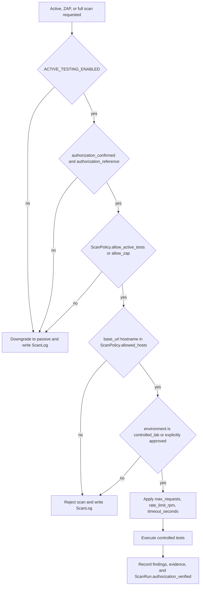
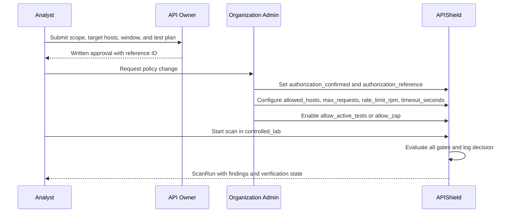

# APIShield scanning authorization and safety policy

| Field | Value |
| --- | --- |
| Version | 1.0.0 |
| Date | 24/11/2026 |
| Applies to | Custom active tests, OWASP ZAP, full assessments |
| Default state | Passive analysis only |

## 1. Policy statement

APIShield may actively test only APIs that the organization owns or is contractually authorized to test. Active testing requires documented owner authorization before a request is sent. Passive analysis of imported specifications and stored metadata is the default. No third-party system may be scanned without written owner authorization and a defined scope.

Anyone who enables active testing must assume the role of an authorized security tester: stay inside scope, minimize traffic, avoid destructive behaviour, stop on unexpected impact, and preserve evidence.

## 2. Required authorization record

| Field | Source | Requirement |
| --- | --- | --- |
| Owner confirmation | `ApiProject.authorization_confirmed` | Must be `True` before active or full scans |
| Authorization reference | `ApiProject.authorization_reference` | Ticket, engagement ID, approval email reference, or signed scope document ID |
| Environment | `ApiProject.environment` | Use `controlled_lab` for first testing and validation |
| Target base URL | `ApiProject.base_url` | Must match the approved target |
| Accountable owner | `ApiProject.owner` | Identifies the person accountable for approval |
| Per-project permission | `ScanPolicy.allow_active_tests` | Must be `True` |
| Per-project ZAP permission | `ScanPolicy.allow_zap` | Must be `True` for ZAP |
| Host allowlist | `ScanPolicy.allowed_hosts` | Contains only approved hostnames |
| Request budget | `ScanPolicy.max_requests` | Caps total active requests |
| Rate budget | `ScanPolicy.rate_limit_rpm` | Caps requests per minute |
| Timeout | `ScanPolicy.timeout_seconds` | Caps per-request wait time |
| Global switch | `ACTIVE_TESTING_ENABLED` | Must be `True` for active traffic |

## 3. Gate sequence



## 4. Approval workflow



## 5. Controlled lab rule

| Phase | Required environment | Allowed traffic |
| --- | --- | --- |
| Rule development | `controlled_lab` | Synthetic endpoints and owned lab services |
| First validation against a real API | `controlled_lab` mirror or staging equivalent | Low-volume passive plus narrowly scoped active checks |
| Production validation | `production`, only with documented approval | Read-only checks within an approved maintenance window |
| Continuous monitoring | Any project | Passive metadata analysis and inbound request observation |

A project defaults to `ApiProject.Environment.CONTROLLED_LAB`. Do not change it to `production` until lab validation is complete and the owner has approved the production scope.

## 6. Allowlist rule

Use `ScanPolicy.allowed_hosts` as a comma-separated list of exact hostnames.

```text
allowed_hosts=lab-api.internal,staging-api.internal
```

| Rule | Requirement |
| --- | --- |
| Exact hostnames only | Do not use wildcard domains or broad CIDR ranges |
| No third-party hosts | Never include vendors, partners, public DNS names, or the public internet |
| Match `base_url` | The project target hostname must appear in the allowlist |
| Review on every engagement | Remove stale hosts after the engagement closes |
| Resolve before scanning | Confirm DNS resolves to the approved owned environment |

## 7. Rate-limit and volume rule

| Control | Default | Operational rule |
| --- | --- | --- |
| `SCAN_RATE_LIMIT_RPM` | 30 | Lower for sensitive or shared services |
| `ScanPolicy.rate_limit_rpm` | 30 | Project value overrides the global expectation |
| `MAX_ACTIVE_REQUESTS` | 40 | Hard ceiling for a single active engagement |
| `ScanPolicy.max_requests` | 40 | Reduce for production validation |
| `SCAN_TIMEOUT_SECONDS` | 15 | Stop slow requests quickly |
| `ScanPolicy.timeout_seconds` | 15 | Keep timeouts below owner-approved limits |
| `BEHAVIOUR_WINDOW_MINUTES` | 10 | Use monitoring to detect unexpected load |
| `REQUEST_FREQUENCY_THRESHOLD` | 120 | Investigate alerts caused by scan traffic |

Start with the lowest practical values, confirm service health with the owner, and increase only with recorded approval. Stop immediately if latency, error rate, or behaviour alerts rise unexpectedly.

## 8. Prohibited activity

| Prohibited | Reason |
| --- | --- |
| Scanning systems without owner authorization | Unauthorized access and legal risk |
| Scanning third-party or public systems | Outside APIShield scope |
| Destructive payloads | Can delete or corrupt data |
| Write, delete, drop, reset, or privilege-escalation operations | Exceeds passive and controlled validation |
| Denial-of-service, fuzzing floods, or unbounded concurrency | Can harm availability |
| Credential stuffing or brute-force login | Can lock accounts and harm users |
| Exfiltration of real customer data | Violates data minimization |
| Injection of persistent content into shared systems | Can affect other users |
| Unapproved production scanning | May breach change control |
| Reusing another engagement's allowlist | Scope must be per engagement |

Safe payloads are limited to non-destructive, non-persistent checks that do not modify business state. Findings must be recorded with enough evidence to reproduce safely and remain `verified=False` until a human confirms them.

## 9. OWASP ZAP safety

`ALLOW_ZAP=True` only permits ZAP when the project policy also allows it. It is not authorization by itself.

| Control | Requirement |
| --- | --- |
| Dedicated instance | Run ZAP in an isolated container or host, not on a workstation with production credentials |
| API credential | Set `ZAP_API_KEY` and restrict network access to `ZAP_API_URL` |
| Context configuration | Define only approved hosts in the ZAP context |
| Spider scope | Restrict spidering to the allowlisted base URL and approved paths |
| Active scan policy | Use non-destructive, low-throughput rules only |
| Authentication | Use test credentials created for the engagement |
| Data handling | Treat ZAP messages, evidence, and reports as sensitive |
| Rate controls | Align ZAP delay and concurrency with `ScanPolicy.rate_limit_rpm` |
| Teardown | Clear sessions, test credentials, and captured tokens after engagement close |
| Audit trail | Link ZAP results to the `ScanRun`, `ScanLog`, and `ScanFinding` records |

Never point ZAP at a public target, a third-party API, a shared production database interface, or a payment, messaging, or identity provider that the organization does not own.

## 10. Operator checklist

| Item | Confirmed |
| --- | --- |
| Written owner approval and reference ID recorded | [ ] |
| Target hosts owned or contractually authorized | [ ] |
| Third-party systems excluded | [ ] |
| Project environment is controlled lab or approved production scope | [ ] |
| `authorization_confirmed=True` | [ ] |
| `authorization_reference` populated | [ ] |
| `allowed_hosts` contains exact approved hostnames | [ ] |
| `allow_active_tests` or `allow_zap` enabled intentionally | [ ] |
| Request cap, rate limit, and timeout agreed with owner | [ ] |
| Test accounts are dedicated and non-production | [ ] |
| No destructive payloads configured | [ ] |
| Monitoring and owner contact available during scan | [ ] |
| Stop condition and maintenance window defined | [ ] |
| Findings will remain unverified until human review | [ ] |
| Teardown and evidence retention plan defined | [ ] |

## 11. Incident response

| Event | Immediate action |
| --- | --- |
| Unexpected latency or errors | Stop the scan, preserve `ScanLog`, notify the owner |
| Out-of-scope host contacted | Stop the scan, record evidence, notify the owner and security lead |
| Sensitive or real user data captured | Stop the scan, restrict access to evidence, follow data incident procedure |
| Credential or token leaked | Revoke the credential, rotate it, and review `LoginAttempt` and API-key usage |
| Destructive effect suspected | Stop all testing, preserve logs, escalate to incident response |
| ZAP behaves outside scope | Disconnect ZAP from the network and review its context configuration |

After every active engagement, close or archive the project policy, remove stale allowlist entries, clean up test credentials, and record lessons learned.
