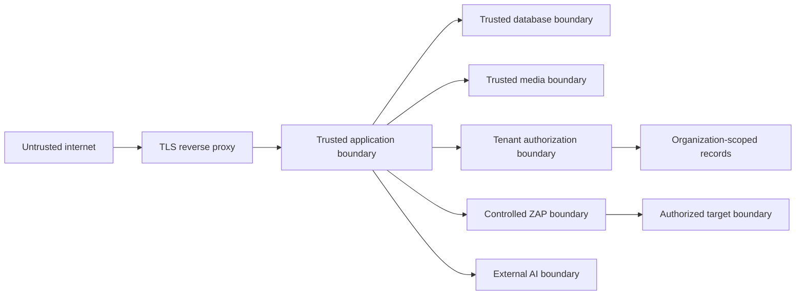

# APIShield threat model

| Field | Value |
| --- | --- |
| Version | 1.0.0 |
| Date | 24/11/2026 |
| Scope | Django application, REST API, scan orchestration, persistence, optional ZAP and Gemini integrations |
| Framework | OWASP API Security Top 10 2023 |

## 1. Assets and adversaries

| Asset | Sensitivity | Why it matters |
| --- | --- | --- |
| User identities and roles | High | Controls tenant and function access |
| API keys and tokens | High | Grant API and integration access |
| OpenAPI specifications | High | Reveal internal endpoints, schemas, and auth design |
| Scan findings and evidence | High | Contain exploitable detail and captured responses |
| Reports | High | Consolidate sensitive assessment output |
| Scan policies and allowlists | Medium | Define where active traffic may be sent |
| Request logs and behaviour alerts | Medium | Reveal traffic patterns and source addresses |
| AI analysis payloads | Medium | May contain finding evidence sent to an external model |
| Media storage | High | Holds reports and uploaded specifications |

| Adversary | Capability | Motivation |
| --- | --- | --- |
| Unauthenticated internet actor | Sends arbitrary requests | Find exposed APIs, enumerate users, exploit misconfiguration |
| Malicious or compromised tenant user | Authenticated with a low or standard role | Escalate role, access another tenant, abuse scanning |
| Curious insider | Viewer or developer membership | Read data outside need-to-know, export reports |
| Supply-chain or integration compromise | Valid token or API key | Abuse trusted API access |
| Misconfigured operator | Administrative access | Enable unsafe scanning or weak deployment settings |
| Malicious specification author | Provides crafted OpenAPI content | Trigger SSRF, parser abuse, or stored injection |

## 2. Trust boundaries

| Boundary | Crossing rule | Primary controls |
| --- | --- | --- |
| Internet to edge | Only approved schemes, hosts, and request sizes | TLS, `ALLOWED_HOSTS`, proxy limits |
| Edge to application | Forwarded protocol and identity headers accepted only from trusted proxy | `SECURE_PROXY_SSL_HEADER`, proxy configuration |
| Application to identity | Every request resolves through an authentication class | Session, token, JWT, OAuth2, API key |
| Identity to tenant | Every resource decision includes an active membership | `OrganizationContextMiddleware`, `has_minimum_role` |
| Tenant to resource | Queries and writes are scoped by organization relationships | Foreign keys, viewset filtering, role mixins |
| Application to database | Only application processes connect | Private network, credentials, TLS |
| Application to media | Reports and uploads are written through Django storage | Extension validation, size limits, filesystem permissions |
| Application to ZAP | Only authorized hosts and non-destructive policy | Dual engine gates, allowlist, isolated instance |
| Application to Gemini | Only when explicitly enabled and reviewed | `AI_EXPLANATIONS_ENABLED`, sanitized context |
| Scanner to target | Only owned or contractually authorized targets | Approval record, environment, allowlist, rate limits |

## 3. OWASP API Top 10 mapping

| OWASP category | Threat scenario | Existing mitigation | Residual risk |
| --- | --- | --- | --- |
| API1 Broken Object Level Authorization | User requests a finding, report, or project from another tenant | Organization foreign keys, membership resolution, organization-scoped views, role mixins | Object-level filtering must be applied consistently in every new viewset |
| API2 Broken Authentication | Stolen token or API key is replayed | Password validators, rotating JWTs, OAuth2, hashed API keys, revocation fields, login attempt logging | Global MFA enforcement is not configured by default; throttles are empty |
| API3 Broken Object Property Level Authorization | Viewer reads sensitive fields in findings or parameters | Role checks, schema inventory, sensitivity flags on parameters | Field-level serialization policy must be enforced per serializer |
| API4 Unrestricted Resource Consumption | Large specification upload or scan overwhelms the service | 10 MB upload caps, extension validation, scan caps, timeouts, rate limits, monitoring thresholds | DRF throttles are empty by default; proxy limits still required |
| API5 Broken Function Level Authorization | Viewer starts a scan or changes a policy | Ranked roles and `HasOrganizationRole`, `IsAdminRole`, `IsAnalystRole`, `IsDeveloperRole` | Each new endpoint must declare the correct required role |
| API6 Unrestricted Access to Sensitive Business Flows | Attacker enumerates sensitive paths or repeatedly calls auth flows | Sensitive path terms, behaviour alerts, login attempt records, authorization gates | Detection thresholds are heuristic and need tuning per deployment |
| API7 Server Side Request Forgery | Crafted `source_url` or `base_url` causes server to fetch internal services | URL fields, host allowlisting for active scans, controlled ZAP context | Specification URL fetching must validate DNS, scheme, and resolved IP before use |
| API8 Security Misconfiguration | Debug mode, weak secret, broad CORS, missing HSTS | Production startup secret check, secure cookies, HSTS, host/CSRF/CORS allowlists, error envelope | Defaults are development-friendly; deployment review is mandatory |
| API9 Improper Inventory Management | Unknown endpoints or stale specifications remain untested | OpenAPI imports, endpoint and parameter inventory, rule catalogue, reports | Inventory freshness depends on owner updates |
| API10 Unsafe Consumption of APIs | Malicious OpenAPI payload or external AI response is trusted | File extension validation, raw content retention, local AI fallback, optional external source | Parsed JSON/YAML and AI output still need strict schema checks and sanitization |

## 4. Threat register

| ID | Threat | Boundary | Likelihood | Impact | Mitigation | Residual risk |
| --- | --- | --- | --- | --- | --- | --- |
| T-01 | Cross-tenant data access through predictable IDs | Tenant to resource | Medium | High | Organization FK on domain models, membership checks, scoped queries | Medium until every viewset has explicit queryset scoping tests |
| T-02 | Viewer role performs analyst or admin action | Identity to tenant | Medium | High | Role rank comparison and role-specific permission classes | Low when endpoints declare required roles |
| T-03 | API key replay from a leaked integration key | Internet to application | Medium | High | SHA-256 storage, active/revocation checks, last-used timestamp, organization binding | Medium without rotation policy and client IP controls |
| T-04 | JWT theft or refresh-token abuse | Internet to application | Medium | High | Short access lifetime, refresh rotation, blacklist after rotation | Medium if client storage is compromised |
| T-05 | Credential stuffing against login | Internet to application | High | Medium | Password validators, login attempt logging, failure monitoring | Medium because global throttle rates are empty |
| T-06 | SSRF through specification URL import | Application to external | Medium | High | URL field, controlled hosts for scanning, isolated ZAP | High until URL resolver validation blocks private networks and redirects |
| T-07 | Unauthorized active scan of third party | Scanner to target | Medium | High | Owner confirmation, authorization reference, environment classification, allowlist, global switch | Medium if operators bypass process or reuse stale approvals |
| T-08 | Destructive ZAP policy | Scanner to target | Low | Critical | Non-destructive policy requirement, isolated instance, rate controls, project `allow_zap` | Medium because tool configuration sits outside Django enforcement |
| T-09 | Malicious OpenAPI file causes parser or storage abuse | External to application | Medium | Medium | Extension validator, 10 MB limits, raw content retained for review | Medium because parser hardening and YAML safe loading must be verified |
| T-10 | Stored injection in finding evidence or report | Application to media | Medium | High | Template escaping, structured JSON evidence, report generation from known fields | Medium without systematic output encoding tests |
| T-11 | Sensitive evidence sent to external AI provider | Application to Gemini | Low | High | Disabled by default, explicit flag, configurable model and key | Medium if enabled without data-sharing review |
| T-12 | Log or error disclosure of request details | Application to client | Medium | Medium | Uniform error envelope with code, message, details, request ID only | Medium if serializers echo raw request or response bodies |
| T-13 | Media tampering or report theft | Application to media | Low | High | Filesystem permissions, scoped report records, volume backup | Medium without encryption at rest and object-level authorization tests |
| T-14 | CSRF on browser session actions | Internet to application | Medium | High | CSRF middleware, trusted origins, SameSite cookies | Low when trusted origins are correct and unsafe methods use CSRF tokens |
| T-15 | Clickjacking of dashboard or admin | Internet to application | Low | Medium | `X_FRAME_OPTIONS=DENY` | Low |
| T-16 | Missing inventory allows shadow APIs | External to application | High | Medium | OpenAPI-driven endpoint registry and scan runs | Medium when specifications are stale |
| T-17 | Behaviour alerts missed due to noisy thresholds | Application to data | Medium | Medium | Configurable windows and thresholds, structured evidence | Medium until tuned to production traffic |
| T-18 | Production startup with default secret | Deployment | Low | Critical | Startup check requires 50-character secret when `DEBUG=False` | Low for web process; other services still need secret hygiene |
| T-19 | Broad CORS allows hostile origin to use session | Internet to application | Low | High | `CORS_ALLOWED_ORIGINS` default deny list | Medium if operators add wildcard or client origins carelessly |
| T-20 | Unverified scanner output treated as fact | Scan to remediation | High | Medium | `ScanFinding.verified=False`, verification records with evidence | Low if UI and API preserve verification state |

## 5. Mitigation summary

| Control class | Implemented controls |
| --- | --- |
| Preventive | Role ranks, organization membership, password validators, hashed API keys, CSRF, host allowlists, upload validation, scan gates, allowlists, request caps, timeouts |
| Detective | Login attempts, request IDs, scan logs, request logs, behaviour alerts, last-used API key timestamp |
| Corrective | API key revocation, token blacklisting, finding status transitions, verification records, report failure status |
| Deterrent | Uniform errors without stack traces, audit trails, authorization references |
| Recovery | PostgreSQL backups, media volume backups, documented restore procedure |

## 6. Residual risks and acceptance criteria

| Residual risk | Acceptance criterion |
| --- | --- |
| Global DRF throttles are not configured by default | Add authenticated and anonymous throttle rates before public deployment |
| MFA is recorded but not enforced | Require `mfa_enabled` for admin roles in deployment policy or add enforcement |
| Specification URL fetching may reach internal networks | Validate scheme, resolved IP, DNS rebinding, and redirects before fetch |
| Active scan process depends on operator discipline | Enforce engagement approval in an external change-control system and review `ScanLog` regularly |
| ZAP safety is partly outside application control | Use isolated tooling, reviewed scan policies, and per-engagement contexts |
| New endpoints can omit tenant filtering | Require RBAC declaration and cross-tenant tests in code review |
| Field-level authorization is serializer-dependent | Add serializer allowlists for sensitive fields and regression tests |
| AI output may be inaccurate | Treat `AiAnalysis` as advisory and keep verification human-controlled |
| Heuristic monitoring may generate false positives | Tune thresholds using a baseline period and document exclusions |
| Reports and evidence may contain real secrets | Redact captured values before export and apply retention policies |

## 7. Review cadence

| Trigger | Action |
| --- | --- |
| New endpoint or serializer | Re-check OWASP API1, API3, API5, and API9 mapping |
| New outbound integration | Re-check trust boundary, SSRF, data sharing, and API10 mapping |
| Scan engine change | Re-check authorization gates, ZAP safety, and API4 limits |
| Authentication change | Re-check API2 controls and token lifecycle tests |
| Production deployment | Confirm mitigation summary and residual-risk acceptance with the owner |
| Quarterly | Review threat register, incidents, alerts, and OWASP mapping changes |
